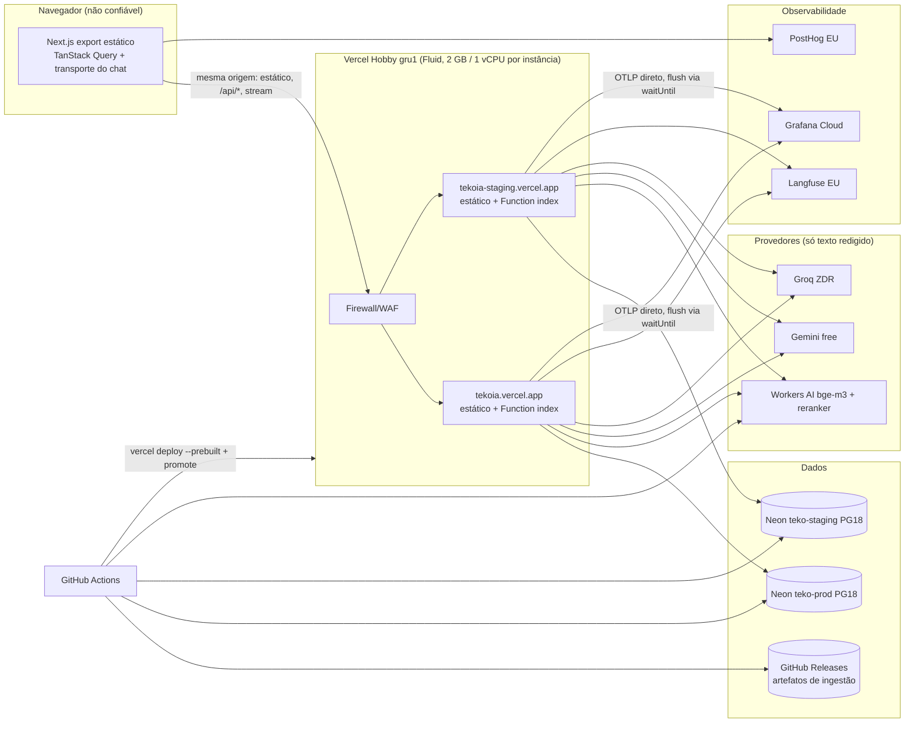
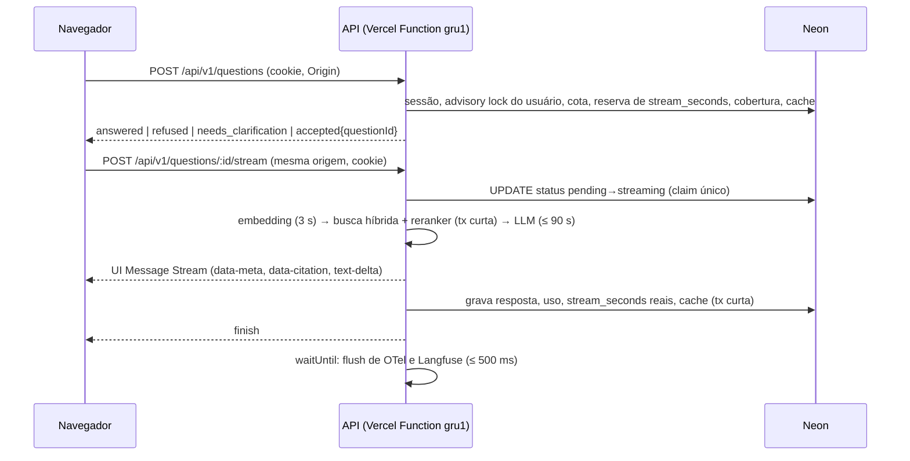

# Arquitetura do Tekó

Desenho vigente do Tekó, com as decisões de 2026-11-12 já aplicadas. O plano de implementação de
2026-11-10 está congelado; a fonte de verdade é este diretório, o [roteiro](../roadmap.md), as
[ADRs](../adr/README.md) e as specs em `openspec/specs/`. Quando o código diverge daqui, vale o
código, e o documento é corrigido no mesmo PR.

| Documento                                            | Conteúdo                                                                            |
| ---------------------------------------------------- | ----------------------------------------------------------------------------------- |
| [backend.md](backend.md)                             | API Fastify: domínio, pipeline HTTP, autenticação, streaming, LLM, Vercel e Plano B |
| [ingestao-e-avaliacao.md](ingestao-e-avaliacao.md)   | Corpus, parsers, embeddings, snapshot, artefatos no GitHub Releases, watch e RAGOps |
| [frontend.md](frontend.md)                           | Export estático do Next, design system, chat, i18n, a11y e segurança no navegador   |
| [qualidade-e-seguranca.md](qualidade-e-seguranca.md) | Matriz de testes, gates, pipeline de segurança, ameaças e LGPD                      |
| [ci-cd-e-ambientes.md](ci-cd-e-ambientes.md)         | Trunk-based, rulesets, workflows, environments, deploy e rollback                   |
| [observabilidade.md](observabilidade.md)             | OTel, Langfuse, PostHog, Grafana, sinais de RAG em produção e runbooks              |
| [contas-e-cotas.md](contas-e-cotas.md)               | Contas, cotas dos planos gratuitos, orçamentos e guard rails                        |

## O que é

O Tekó é um assistente RAG de código aberto (MIT) sobre a EFD ICMS/IPI, a EFD-REINF, o RCTE e o
CTE de Goiás e a EFD-GO. Ele resolve a data de referência (em geral o período de apuração),
filtra a busca por vigência em SQL, cita dispositivo, versão e intervalo de vigência, e recusa
quando a data está fora da cobertura. Tudo com custo zero absoluto: só planos gratuitos que param
em vez de cobrar, sem cartão em nenhum serviço. É uma ferramenta profissional, com termos 18+.

**Nome.** "Tekó" em todo texto visível (UI, `<title>`, `rpName` do passkey, tela de OAuth,
READMEs); `teko` nos identificadores técnicos (`@teko/shared`, cookies `teko`, `teko-prod`).
O domínio público é `tekoia.vercel.app`, porque `teko.vercel.app` pertence a terceiros.

## Restrições

| Restrição                              | Consequência                                                                                                       |
| -------------------------------------- | ------------------------------------------------------------------------------------------------------------------ |
| Custo zero absoluto                    | Só free tiers que param em vez de cobrar; tetos calculados abaixo das cotas; nenhum cartão cadastrado              |
| Sem domínio próprio                    | Web e API no mesmo domínio `*.vercel.app` (ADR 0029); login por OAuth GitHub/Google + passkey, sem e-mail          |
| Vercel Hobby: cotas mensais fixas      | Estourar uma cota bloqueia o recurso por cerca de 30 dias; tetos na aplicação, WAF, guarda diária de uso e Plano B |
| Vercel Hobby é pessoal e não comercial | Gratuito e MIT, sem anúncios, afiliados, plano pago ou consultoria paga ligada ao deploy; doações permitidas       |
| Gemini free usa os prompts para treino | PII redigida, aviso na UI, termos 18+, EEE/UK/CH só no Groq (ZDR), opt-out de Model Training na Vercel             |
| Mantenedor solo, máquina pessoal       | Nada depende da máquina dele: tudo reproduzível pelo Actions e por `infra/`                                        |

Os testes usam relógio fixo em **2026-11-10**.

## Visão geral



- **`apps/web`**: export estático do Next, servido pela CDN da Vercel no mesmo projeto da API. Não
  tem lógica de negócio.
- **`apps/api`**: toda a lógica, em arquitetura hexagonal. A API, a CLI de ingestão e as evals
  compartilham o domínio. Na Vercel, é uma única Function `index` em Fluid compute.
- **`tools/ingest`**: Python com Docling, só para PDFs. Roda no Actions e não guarda segredos.
- **Vercel**: dois projetos, `tekoia` (produção) e `tekoia-staging`. Cada deploy publica um único
  `.vercel/output`, com o estático em `static/` e a Function `index`, que só atende `/api/*` e
  `/healthz` (ADR 0029). Nenhum estado na instância além de caches descartáveis (cobertura,
  `corpus_version`).

### Fronteiras de confiança

| Fronteira                                  | Regra                                                                                                                                                                                                              |
| ------------------------------------------ | ------------------------------------------------------------------------------------------------------------------------------------------------------------------------------------------------------------------ |
| Navegador → Vercel                         | Não confiável. WAF na frente; mutações exigem `Origin` igual ao domínio do ambiente e `content-type: application/json`; sessão por cookie `SameSite=Lax`; IP do cliente pelo `x-real-ip`, que a Vercel sobrescreve |
| Vercel (plataforma)                        | Operador de dados: opt-out de Model Training, segredos como env vars Sensitive, Deployment Protection Standard, logs de runtime de 1 h sem a pergunta crua                                                         |
| Vercel → LLM, embeddings e observabilidade | Sai só texto redigido; hosts dos provedores conferidos no boot                                                                                                                                                     |
| GitHub Actions                             | Única origem com credencial de escrita no corpus, nos artefatos de ingestão e de deploy (`VERCEL_TOKEN`). Forks nunca recebem segredos                                                                             |

### Fluxo de uma pergunta



## Estrutura do repositório

```text
teko/
├─ apps/
│  ├─ web/          # Next.js estático: app/ (rotas), src/{components,lib}, messages/{en,pt-BR}.json
│  └─ api/          # Fastify hexagonal: src/{domain,application,adapters,config}, drizzle/, evals/, test/
├─ packages/shared/ # contracts, errors, vigencia, pii, analytics, i18n
├─ tools/
│  ├─ ingest/       # Python + uv + Docling
│  └─ vercel-cli/   # Vercel CLI isolado, com lockfile e exceções de proveniência próprios (ADR 0002)
├─ corpus/          # sources.yaml, leiaute-periods.yaml, overrides/, watch.yaml, corpus.lock.json
├─ scripts/         # scripts da raiz em TypeScript (type stripping): build/pack do .vercel/output etc.
├─ infra/           # local/ (compose), vercel/ (WAF, env não secreta), planb-render/
├─ openspec/        # specs/ (requisitos vigentes) e changes/
├─ docs/            # roadmap.md, status.md, architecture/, adr/, runbooks/
└─ .github/         # workflows/, actions/setup/, affected-paths.yml, dependabot.yml, CODEOWNERS
```

Há três pacotes JS (`@teko/web`, `@teko/api`, `@teko/shared`). k6, promptfoo e os testes ficam
dentro de `apps/api`. O `.vercel/` é gerado no CI, fica no `.gitignore` e nunca entra em artifact
nem release.

**Versões.** Vale o `catalog` do `pnpm-workspace.yaml`, com release de pelo menos 7 dias e
proveniência (ADR 0002). Este diretório cita versões só quando a escolha é parte da decisão.

## Decisões e desvios do pedido original

Tabela viva, que substitui a da ADR 0001 (histórica, de 2026-11-11).

| Pedido original / pesquisa               | Decisão                                                                                                                        | Motivo                                                                                                     |
| ---------------------------------------- | ------------------------------------------------------------------------------------------------------------------------------ | ---------------------------------------------------------------------------------------------------------- |
| Fastify em Netlify Functions             | Fastify (Node 24) como uma Vercel Function (Fluid) no Hobby, `gru1`, deploy `--prebuilt` do output atestado (ADRs 0004 e 0017) | 60 s e Ohio na Netlify; o Hobby dá 300 s com streaming, região junto do Neon e pausa em vez de cobrar      |
| Front na Netlify com proxy assinado      | Web e API na mesma origem na Vercel: o estático vai no mesmo `.vercel/output` da API (ADR 0029)                                | Sem proxy, ticket, CORS, corte de 26 s nem segundo pool de cotas; cookie e passkey num host único          |
| VM Oracle Always Free A1                 | Descartada                                                                                                                     | O cadastro no Brasil exige CNPJ                                                                            |
| Staging como Preview da Vercel           | Dois projetos (`tekoia`, `tekoia-staging`), cada um com domínio de produção próprio                                            | Custom Environments são Pro; previews ficam atrás do Vercel Authentication                                 |
| Rate limit em memória                    | WAF no stream, `QuotaGuard` e Better Auth nas rotas que cobrem; `@fastify/rate-limit` em Postgres só onde nenhum deles cobre   | A Fluid escala para várias instâncias                                                                      |
| Netlify DB                               | Neon Free PG18, dois projetos (`teko-prod`, `teko-staging`)                                                                    | Custo zero com cota própria por projeto                                                                    |
| Next com SSR                             | `output: 'export'`, sem route handlers nem functions do Next                                                                   | A Function única da API já consome as cotas do Hobby                                                       |
| Netlify Blobs para artefatos de ingestão | GitHub Releases (prerelease por tipo de artefato, assets pelo sha256) (ADR 0030)                                               | Sai a última dependência da Netlify; artefatos públicos e versionados junto do repositório                 |
| Domínio próprio e e-mail                 | `*.vercel.app` e login por OAuth GitHub/Google + passkey                                                                       | Sem domínio não há remetente de e-mail confiável                                                           |
| Langfuse self-hosted                     | Langfuse Cloud Hobby (EU); self-hosted só no dev local                                                                         | Exige 4 vCPU, 16 GB e ClickHouse                                                                           |
| Sentry para erros                        | PostHog Error Tracking na F6, se cobrir source maps e relatório de CSP; senão, Sentry                                          | Menos uma conta                                                                                            |
| LLM pago                                 | Gemini free (flash → flash-lite) → Groq `openai/gpt-oss-120b` com ZDR                                                          | Custo zero                                                                                                 |
| Embeddings e reranker                    | BGE-M3 e `bge-reranker-base` no Workers AI, com degradação rotulada (ADR 0027)                                                 | Cota diária grátis com hard stop                                                                           |
| Git Flow e Changesets                    | Trunk-based: `main` é o tronco (push = staging) e produção sai por tag `v*`; changelog pelo git-cliff (ADR 0033)               | Mantenedor solo; sem back-merge, `gitflow-guard` nem PR de release em `pull_request` (ADR 0024)            |
| Gates no PR para tudo                    | PR com a camada rápida; Stryker só no nightly, `pnpm audit` fora do PR, Sonar informativo, sem Codecov (ADR 0032)              | PR gate de 5,8 min de mediana, com o Stryker no caminho crítico, e advisories novos bloqueando PRs alheios |
| Avaliação só na fixture                  | `corpus-eval` bloqueia o PR do lock; golden `dev` e `holdout`; linhagem e rollback do corpus (ADR 0031)                        | Ajustar e medir no mesmo conjunto superestima a qualidade                                                  |
| Merge queue                              | `strict` status checks                                                                                                         | Indisponível em repositório de usuário                                                                     |
| Carga e DAST ativo no ambiente real      | Só na stack efêmera de CI, com os limites de uma instância Fluid                                                               | No real queimaria CU-h, cota de LLM e as cotas do Hobby                                                    |
| Plugins remote-only do promptfoo         | Plugins locais + casos YAML escritos à mão                                                                                     | Os remotos falham sem geração remota ou enviam dados ao serviço                                            |
| Scorecard alto desde o início            | ≥ 7 na v0.1.0 e ≥ 8 na v0.2.0                                                                                                  | `Maintained` só pontua após 90 dias; Code-Review exige segundo revisor                                     |
| Trusted Types em enforce                 | Report-only até depois da v0.1.0                                                                                               | Risco de quebra por dependências                                                                           |
| Anexos VIII/IX do RCTE junto do corpo    | Onda C3, na F10                                                                                                                | Arquivos de 57 e 73 MB e o limite de 1 GB do Neon                                                          |
| Cortes da revisão de 2026-11-12          | Saem playwright-bdd, FSD/steiger, Stryker no web, mutmut, Storybook, k6 stress/soak, Checkly, e2e cross-browser e visual       | Custo de manutenção alto para um mantenedor; detalhes no [roteiro](../roadmap.md#cortes-e-adiamentos)      |
